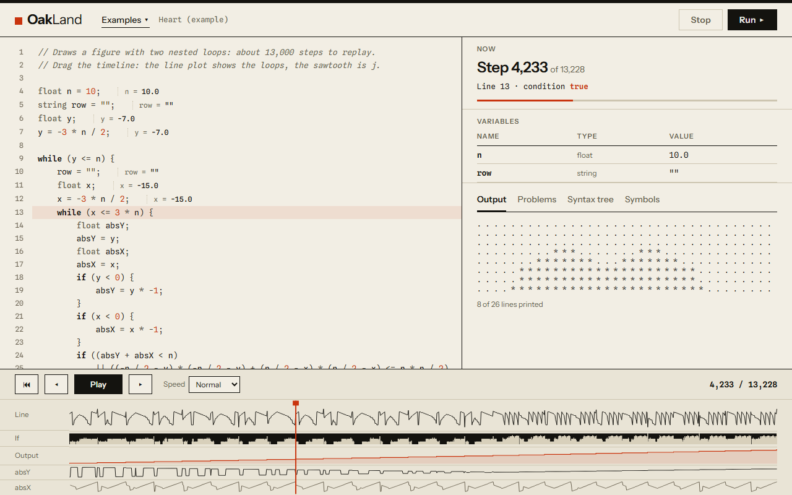
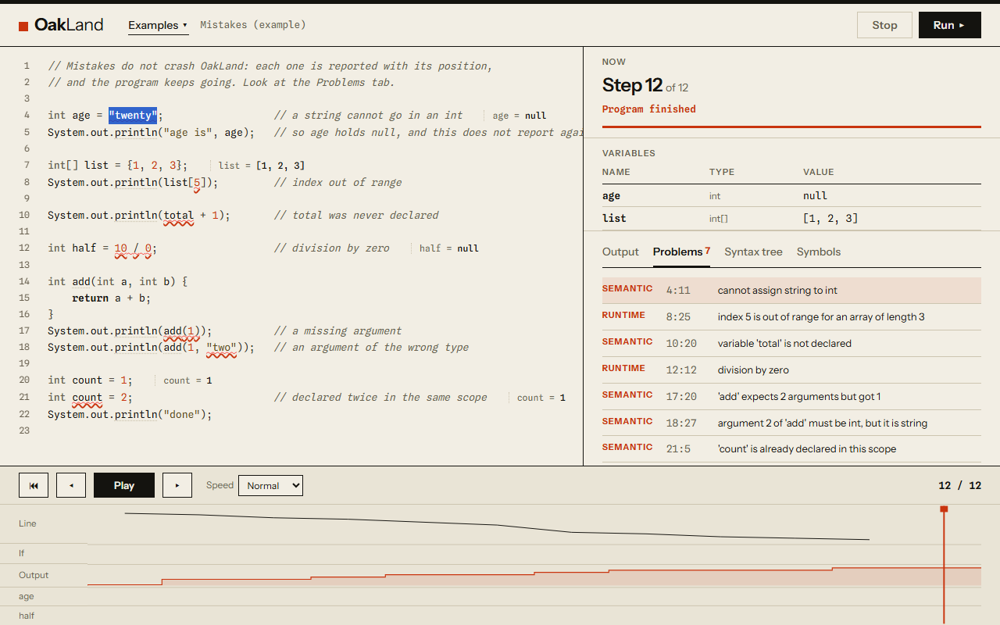
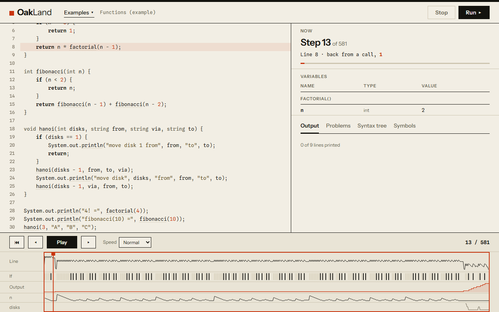
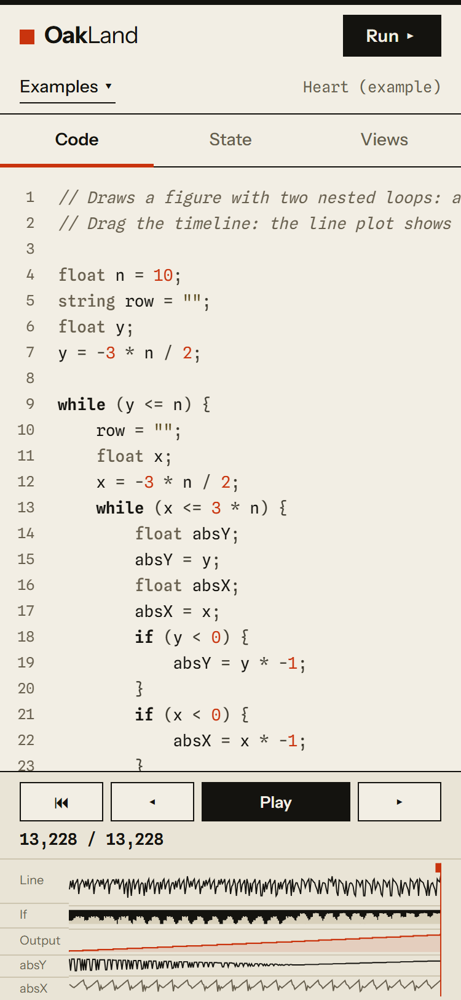

# OakLand

**A small Java-like language, and an interpreter you can watch run.**

Write a program, press Run, then drag through its execution: the line being run, every variable, the call stack, the output so far and the syntax tree, at any of up to 20,000 recorded steps. Everything runs in your browser; nothing is sent anywhere.

**Live:** <https://henryd11703.github.io/OLC2_Proyecto1_202004071/>



OakLand began as a university project for the compilers course (OLC2, USAC): an interpreter with a Peggy-generated parser and a Monaco editor. This version is a rebuild: a hand-written lexer and parser, a tree-walking interpreter with Java-like semantics, a recorded trace, and an interface made to explain what a program does.

## What you can do

- **Step through a run.** The timeline at the bottom is drawn from the whole trace: the line that was running, which conditions held, what had been printed, and the values of the numeric variables that change most. Drag it, or use the arrow keys (`Shift` for 100 steps, `Home`/`End`).
- **See the call stack.** Recursion shows one frame per call, with the variables of each; the line that made a call is marked again when the call returns.
- **See values next to the code.** Each line that assigns a variable shows its current value at the end of the line.
- **Read mistakes, not stack traces.** Every problem (syntax, types, names, arguments, bounds, division by zero, runaway loops) is a message with a line and column, underlined in the editor and listed under *Problems*. A bad program never crashes the page.
- **Look inside.** *Syntax tree* shows how the interpreter parsed the program, *Symbols* lists every name it declares; clicking either jumps to the source.
- **Try examples** (Hello, Basics, Control flow, Arrays, Functions, Structs, Heart, Mistakes), open a `.oak` file, or save yours.

| Mistakes with their positions | A recursive call stack | On a phone (375 px) |
|---|---|---|
|  |  |  |

## The language

Static types (`int`, `float`, `string`, `boolean`, `char`, arrays and matrices of any depth, structs), functions with recursion, `if`/`while`/`for`/for-each/`switch`. `int` is 32-bit, floats print like Java, and strings join with anything.

```java
struct Person { string name; int age; }

int factorial(int n) {
    if (n == 0) { return 1; }
    return n * factorial(n - 1);
}

Person ana = Person{name: "Ana", age: 20};
ana.age++;
System.out.println(ana.name, "is", ana.age, "and 5! is", factorial(5));
```

The full reference is [`docs/LANGUAGE.md`](docs/LANGUAGE.md). **Every example in it is run by the test suite**, so it cannot drift from the interpreter. The grammar is [`docs/grammar.ebnf`](docs/grammar.ebnf), and what changed from the original course interpreter, line by line, is [`docs/language-changes.md`](docs/language-changes.md).

## Run it yourself

```bash
npm ci
npm run dev        # http://localhost:5173
npm run check      # lint + types + unit tests
npm run test:e2e   # builds, serves and tests the page in Chromium (desktop and phone, with axe)
npm run build
```

Node 20.19 or newer. Nothing else: no backend, no Docker, no environment variables.

## How it is built

```
src/core/       the interpreter: lexer, parser, tree-walking interpreter, trace, symbols. No DOM.
src/worker/     runs a program in a Web Worker; Stop ends the worker
src/ui/         React interface, CodeMirror 6 editor, timeline
src/examples/   the eight example programs (English)
docs/           principles, spec, plan, tasks, language reference, design notes
tests/ e2e/     unit, golden, fuzz and documentation tests; Playwright end-to-end tests
```

The design decisions, and the alternatives that were rejected, are in [`docs/ARCHITECTURE.md`](docs/ARCHITECTURE.md). The project was written spec-first: [principles](docs/00-principles.md), [spec](docs/01-spec.md) with 39 measurable acceptance criteria, [plan](docs/02-plan.md) and [tasks](docs/03-tasks.md), which ends in a table mapping each criterion to the test that checks it.

## Testing

- **718 unit tests**: lexer, parser (with a corpus of syntax errors and their exact positions), every operator and statement, structs, built-ins, limits, the trace and its replay, the symbol table, the timeline data.
- **Golden files** pin the output of the seven original course programs, and the way it differs from the original interpreter's (`tests/golden/legacy-diff/`). The course's own hand-written expected outputs are checked too.
- **Fuzzing**: 1,000 mutations of the samples and 500 token soups, seeded, must never make `run()` throw. (A one-off 20,000-case run found no exception.)
- **48 end-to-end tests** (24 on a desktop and 24 on a phone viewport) with axe accessibility scans of every panel: Stop on a runaway loop, jumping from a problem to its line, stepping by keyboard, opening and saving files.

## Honest limits

- **Recursion is limited to 400 nested calls** (Java allows thousands). The interpreter uses the JavaScript stack, which gives out first; a recursive sum up to 1000 does not fit.
- A run is bounded: 20 million steps, 5 seconds, 200,000 characters of output, 1,000,000 elements per array. Past that it stops with a diagnostic and keeps its output.
- The trace records up to 20,000 steps; longer runs complete but the timeline says it was cut.
- Lighthouse on a simulated slow phone: Performance 82–100 across runs (median 83); Accessibility, Best Practices and SEO 100. Desktop preset: 93.

## License

MIT. The language and the original interpreter come from a university course project; this rebuild is by Henry Quel.
